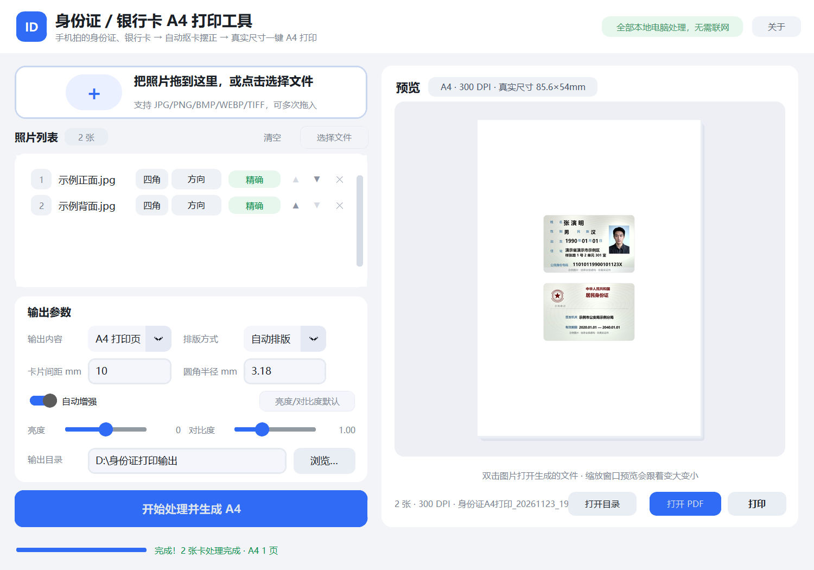
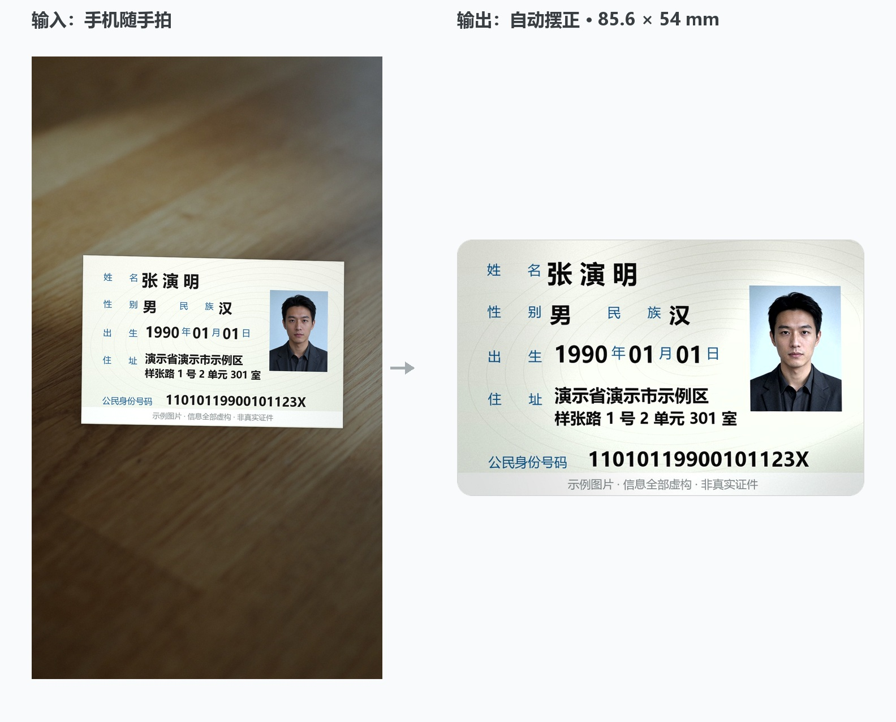
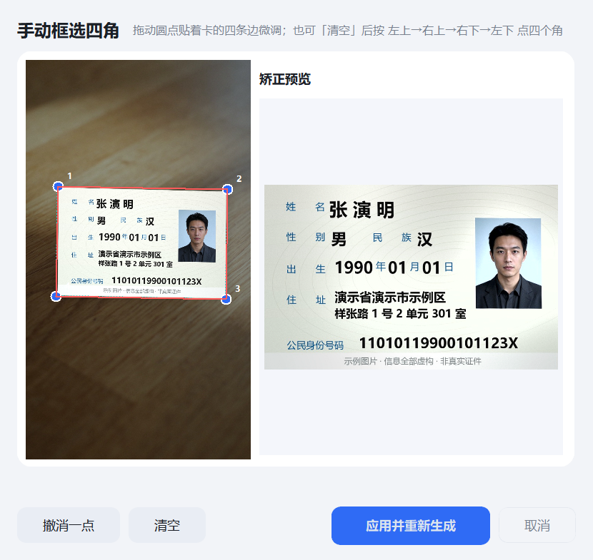
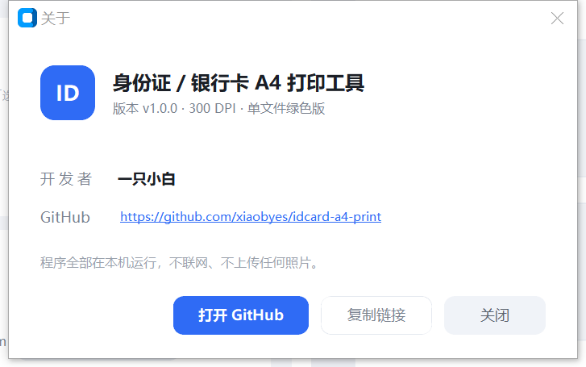
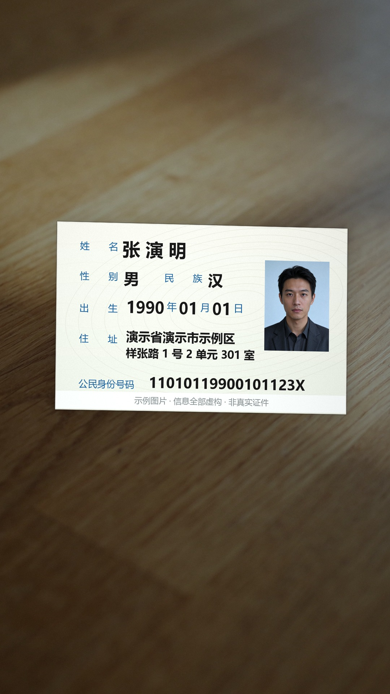
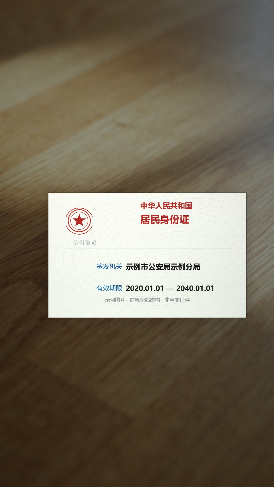

# 身份证 / 银行卡 A4 打印工具


> 开发者：**一只小白** · 仓库：<https://github.com/xiaobyes/idcard-a4-print>

手机随手拍的证件照片，自动找卡边、透视摆正、裁成真实尺寸 **85.6 × 54 mm**（300 DPI = 1011 × 638 像素，圆角 3.18 mm），排到 A4 上直接打印。界面双击即用，**全程本地处理，照片不出电脑**。



> 仓库内的卡面与截图均为演示用虚构样品（人像为 AI 生成的虚构人物，姓名、号码、住址均为编造），不含任何真实证件信息。

### 一张斜着拍的手机照片，直接变成能打印的卡



---

## 为什么做这个

市面上多数「证件打印」工具要么要求把照片裁成固定比例手动框选，要么输出尺寸不对（打出来是 A4 大小的巨卡），要么必须联网上传。这个小工具只做一件事：**让拍歪的手机照片变成能直接打印的、尺寸分毫不差的证件卡**。

---

## 功能

- **自动找卡**：背景色差估底色 → 色差图 Otsu → 开运算去噪 → 最大连通域 → 逐行极值取四边 → 凸包 → `minAreaRect` → 亚像素精修，透视变换到正视角。
- **真实尺寸**：卡面输出 1011 × 638 px @300 DPI，圆角半径 3.18 mm，A4 排版按毫米实摆，打印时选「实际大小 / 100%」即与真卡完全一致。
- **方向绝不倒、绝不镜像**：文字行投影 + 版面特征打分判定 0° / 180° 或 90° / 270°，镜像只做一次明确的翻转判断，不会出现「字反着」的成品。
- **一图两卡自动拆**：一张照片里同时拍到正反面，自动裁成两张分别摆正。
- **拍不全自动补齐**：卡的边缘被画面切掉、但卡面信息完整时，用卡面文字块反推整卡位置（模板透视 + 边界外推），输出仍是完整的 85.6 × 54 mm。
- **手动四角微调**：每行「四角」按钮打开校正窗口，拖四个控制点贴住卡边，右侧实时预览校正结果。
- **列表管理**：多张拖入、▲▼ 调顺序、✕ 删除；每行「方向」按钮按 90° 循环兜底。
- **直连系统打印**：点「打印」由程序自绘 GDI 页面，按真实尺寸直接送打印机，不经过阅读器二次缩放。
- **版本与关于**：右上角「关于」显示版本号、开发者与 GitHub 地址，可一键打开仓库或复制链接；命令行 `-V/--version` 输出同样信息。
- **纯本地**：无网络请求、无上传、无账号。

| 四角微调 | 关于 |
| --- | --- |
|  |  |

示例素材（手机斜拍、卡占画面一半，程序自动找边摆正）：

| 人像面输入 | 国徽面输入 |
| --- | --- |
|  |  |

---

## 快速开始

### 方式一：下载 EXE（推荐给普通用户）

到 [Releases](../../releases) 下载 `身份证A4打印工具.exe`，单个文件，双击即用。

- 64 位 Windows 10 / 11，无需安装 Python 或任何运行库。
- 单文件包，首次启动需解包，约 5~15 秒；之后较快。
- 未做代码签名，Windows Defender / 国产杀软可能提示「未知发布者」，加入信任即可。
- 建议放在普通目录（如 `D:\工具\`），不要放 `C:\Program Files`（无写权限会存不了输出）。
- 默认输出到 `程序所在目录\输出`，可在界面「输出目录」里改。

### 方式二：源码运行

```bash
pip install -r requirements.txt
python idcard2a4.py                 # 打开图形界面
python idcard2a4.py 照片文件夹 -o D:\输出
```

源码依赖 Python 3.10+（开发环境为 3.12 x64），需要 Tk 支持（Windows 官方安装包自带）。

---

## 图形界面

1. 把照片拖进上方区域，或点「选择文件」。
2. 左下列表里核对每张的识别状态：`精确` / `已校正` / `补齐`（拍不全后补的）/ `失败`。
3. 需要修正时点该行「四角」拖点，或点「方向」按 90° 循环。
4. 设置输出内容（A4 打印页 / 每张证件图 / 两者）、排版方式、卡间距、圆角、增强与亮度对比度。
5. 「开始处理并生成 A4」，完成后右侧可「打开目录 / 打开 PDF / 打印」。

打印建议：纸张 A4、缩放「实际大小」或 100%、不要勾「适应页面」。

---

## 命令行

```
python idcard2a4.py [照片或文件夹 ...] [选项]
```

| 参数 | 说明 |
| --- | --- |
| `inputs` | 照片文件或文件夹，可多个 |
| `-o, --out` | 输出目录，默认为桌面下 `身份证打印输出` |
| `-f, --fmt` | `a4`（只出 A4 打印页，默认）/ `image`（每张证件一张 PNG）/ `both` |
| `-l, --layout` | 排版：`auto` / `single`（每页一张）/ `pair`（一页一对）/ `grid`（网格） |
| `-r, --rotate` | 方向微调：`自动` / `不旋转` / `顺时针90` / `180` / `逆时针90` |
| `--corner` | 圆角半径（毫米），默认 3.18，`0` 为直角 |
| `--gap` | 卡片间距（毫米），默认 10 |
| `--no-clean` | 关闭自动增强（亮度/对比度归一） |
| `--marks` | 打印裁切框线 |
| `--gui` | 打开图形界面 |
| `-V, --version` | 显示版本号、开发者与仓库地址 |

输出文件命名：`身份证A4打印.pdf`、`身份证A4打印_预览_第N页_时间.png`、`证件卡片_NN_原文件名.png`。

---

## 处理流程

```
读图(EXIF 摆正)
   ├─ 找卡：底色估计 → 色差图 → Otsu → 形态学去噪 → 最大连通域
   │        → 逐行/逐列极值取四边 → 凸包 → 最小外接矩形 → 亚像素精修
   ├─ 兜底：卡面文字块聚类 → 角度搜索最小外接 → 与标准版面文字块求透视
   └─ 补齐：卡边出画 → 用文字块模板反推整卡，边界外推补白
透视变换 → 1011×638
   ├─ 方向判定(0/90/180/270，禁镜像)
   ├─ 一图两卡拆分(内外框面积/位置判断)
   └─ 圆角 + 白边 + 自动增强
A4 300DPI 排版 → PDF(pypdf 合并) / PNG
```

版面依据：中国二代居民身份证 85.6 × 54 mm，四角圆角 3.18 mm；同一尺寸的银行卡、社保卡、驾驶证等同样适用。

---

## 目录结构

```
idcard-a4-print/
├─ idcard2a4.py           # 核心：识别、校正、排版、CLI 入口
├─ idcard_ui.py           # 图形界面（customtkinter + tkinterdnd2）
├─ build.spec             # PyInstaller 单文件打包配置（相对路径）
├─ requirements.txt
├─ assets/app.ico
└─ docs/
   ├─ 使用说明.md          # 面向终端用户的图文说明
   └─ screenshots/        # 界面与示例图（虚构样品）
```

---

## 自己打包成单文件 EXE

```bash
pip install -r requirements.txt pyinstaller
pyinstaller --noconfirm build.spec
```

产物在 `dist/身份证A4打印工具.exe`，约 80 MB（内含 OpenCV 与 Tk 运行时），单文件即可拷到任意 64 位 Windows 运行。

---

## 已知限制

- 白卡放在白桌布、强反光、卡被手指遮挡过半：自动识别可能失败，用「四角」手动框一次即可。
- 卡面信息被切掉（而不只是卡边出画）时无法补齐，只能重拍。
- HEIC 依赖 Pillow 的额外插件，部分机器读不了，建议先转 JPG。
- 只支持 85.6 × 54 mm 规格的卡片，护照、驾照本等不适用。
- 识别在 CPU 上跑，单张约 0.5~2 秒。

---

## 隐私

- 全部计算在本机完成，程序不发起任何网络请求。
- 输出文件只写在你指定的目录，缩略图缓存只写系统临时目录。
- 仓库内的示例图与截图全部是程序绘制的虚构样品，不含真实证件信息。

---

## 参考

- 尺寸与排版思路参考 [jrsdhr/idcard-a4-tool](https://github.com/jrsdhr/idcard-a4-tool)。
- 识别流程参考 OpenCV 经典文档定位方案（色差分割 + 最小外接矩形 + 透视变换）。

## 版本

| 项目 | 内容 |
| --- | --- |
| 当前版本 | **v1.0.0** |
| 开发者 | 一只小白 |
| 仓库 | <https://github.com/xiaobyes/idcard-a4-print> |
| 界面查看 | 右上角「关于」按钮 |

---

## 许可

MIT，见 [LICENSE](LICENSE)。
